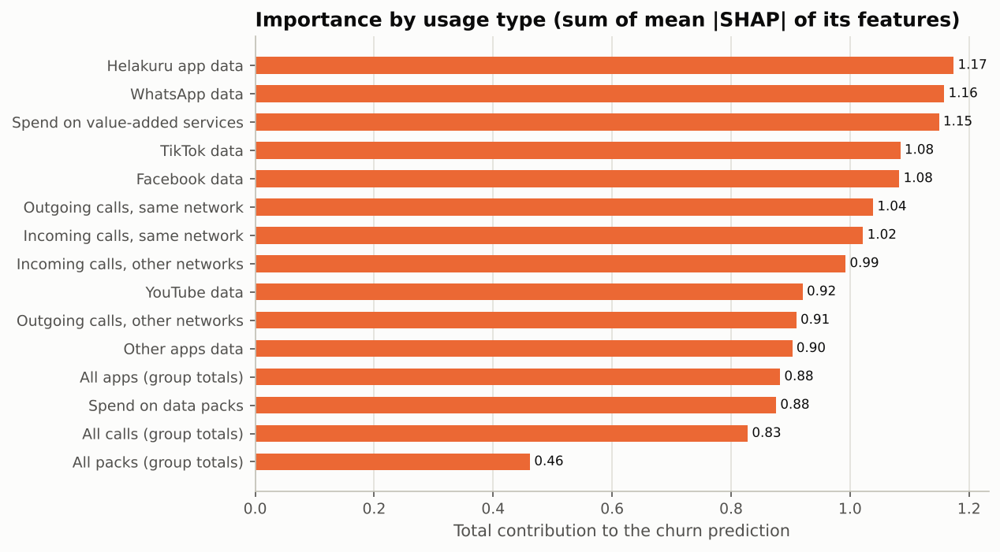

# Telco Churn Early Warning (Sri Lanka)

MSc Applied Machine Learning assignment. Predicts which mobile customers of a Sri Lankan operator will **leave the network (churn)**, using only their **first month** of usage, compares models from a weak baseline to stacked ensembles, explains the model with **SHAP and LIME**, and serves it in a **Streamlit** app.

## 1. Local problem

Sri Lankan mobile operators compete hard, and customers move between networks easily. Keeping a customer is cheaper than winning a new one, so an operator wants an **early warning**: a list of customers likely to leave, early enough to offer them a retention package.

## 2. Dataset

- **Real World Customer Churn Dataset in Telco Domain** (Kaggle, Lasal Jayawardena, CC0): https://www.kaggle.com/datasets/lasaljaywardena/real-world-churn
- 65,005 anonymised customers of one of the largest telcos in Sri Lanka, 1 January to 31 March 2023 (90 days), with the author's train / test split (52,004 / 13,001). Churn rate 23%.
- 12 daily usage types: Facebook, TikTok, YouTube, WhatsApp, **Helakuru**, other apps (MB), data packs and value-added services (LKR), and four call types (minutes).
- `data/raw/customer_first30.csv` is built from the original `main.csv` by `src/build_dataset.py`: for each usage type, the average per day in days 1-10, 11-20 and 21-30, plus active days (48 columns).

## 3. The leakage problem (key finding)

With all 90 days, every model scores **ROC-AUC 1.000**. Churners' usage collapses in months 2-3, so the model only sees that the customer has already left. That predicts nothing useful. **Only days 1-30 are used**, which makes this a real early-warning task. See `notebooks/01_eda.ipynb`, section 3.

## 4. Method

| Step | What was done | Where |
|---|---|---|
| Data understanding | Column meanings, quality checks, skewness, class balance, leakage check, churner behaviour | `notebooks/01_eda.ipynb` |
| Preprocessing | No missing / duplicate / negative values found; median imputation kept in the pipeline; signed log + standard scaling for Logistic Regression; no scaling needed for trees | `src/train.py` |
| Feature engineering | Per usage type: change and end/start ratio between days 1-10 and 21-30; group totals, ratios and active-day averages for apps, packs, calls (90 features) | `src/features.py` |
| Models | Majority baseline, Logistic Regression, Decision Tree, Random Forest, AdaBoost, XGBoost, LightGBM, CatBoost, Soft Voting, Stacking | `src/train.py` |
| Tuning | Hand-set parameters for all models; RandomizedSearchCV (stratified 3-fold, PR-AUC) for RF, XGBoost, LightGBM | `reports/hyperparameters.csv` |
| Model choice | Best validation PR-AUC on a 20% validation split of the training data (test set not used); ties within 0.001 go to the faster model | `src/train.py` |
| Imbalance | Class weights; judged by F1 / recall / PR-AUC for churn, not accuracy | |
| Explainability | SHAP (global bar, beeswarm, by usage type, dependence, one-customer waterfall) and LIME (one customer) | `src/explain.py` |
| App | Inputs for 12 usage types -> churn probability + top-10 SHAP reasons | `app/app.py` |

## 5. Results (test set, 13,000 customers)

| Model | Accuracy | Precision | Recall | **F1 (churn)** | ROC-AUC | PR-AUC |
|---|---|---|---|---|---|---|
| Majority baseline | 0.771 | 0.000 | 0.000 | 0.000 | 0.500 | 0.229 |
| Logistic Regression (weak) | 0.917 | 0.763 | 0.923 | 0.835 | 0.975 | 0.929 |
| Decision Tree | 0.860 | 0.661 | 0.800 | 0.724 | 0.912 | 0.780 |
| Random Forest (bagging) | 0.933 | 0.843 | 0.869 | 0.856 | 0.977 | 0.938 |
| AdaBoost | 0.973 | 0.949 | 0.933 | 0.941 | 0.995 | 0.986 |
| **XGBoost (selected)** | **0.980** | 0.944 | 0.971 | **0.957** | 0.998 | 0.993 |
| LightGBM | 0.983 | 0.954 | 0.970 | 0.962 | 0.998 | 0.994 |
| CatBoost | 0.981 | 0.940 | 0.981 | 0.960 | 0.998 | 0.994 |
| Soft Voting (XGB + LGBM + CatBoost) | 0.982 | 0.949 | 0.974 | 0.961 | 0.998 | 0.994 |
| Stacking (RF + XGB + LGBM -> LR) | 0.983 | 0.959 | 0.967 | 0.963 | 0.997 | 0.991 |


- The majority baseline is 77% accurate but finds **no** churners, which is why accuracy is not used to choose.
- Gradient boosting clearly beats the weak model: F1 **0.835 -> 0.957**, false alarms fall from 855 to 173 (about 80% fewer) and missed churners from 228 to 87.
- XGBoost, LightGBM, CatBoost, voting and stacking are within 0.01 F1 of each other. XGBoost was chosen: its validation PR-AUC was within 0.001 of the best, and it trains fastest (about 5 s) with a small file (0.7 MB).
- Held-out customer (kept out of training and testing): churn probability **0.998**, actually churned. Correct.

## 6. Explainability




- Churn appears as a **decline in all services together**; no single app decides it. Helakuru, WhatsApp and value-added services rank highest by usage type.
- Top single features: the apps end/start ratio and the apps and calls totals in days 21-30.
- For the held-out customer, SHAP and LIME agree on the main story: value-added services and same-network calls dropped to almost zero by days 21-30 and Facebook use was rare, which pushes towards churn. They differ in detail: SHAP gives the largest single push to WhatsApp active days, while LIME shows that still-high YouTube, data-pack and other-network call use argued against churn, but not enough.

## 7. Limitations

- Results are unusually high for telco churn. Several usage types have almost identical distributions and stayers' usage rises steadily, which suggests the values were rescaled or partly generated during anonymisation. A live system would likely score lower.
- One operator, one quarter (January to March 2023); no customer profile, price plan or network-quality data.
- The usage units come from the dataset description and could not be verified.

## 8. How to run

```bash
python -m venv .venv
.venv\Scripts\activate             # Windows (macOS / Linux: source .venv/bin/activate)
pip install --upgrade pip setuptools wheel
pip install -r requirements.txt
python src/train.py                # about 20 min with tuning (reuses reports/tuned_params.json; add --retune to search again)
python src/evaluate.py
python src/explain.py
python src/predict.py
streamlit run app/app.py
```

If `models/model.pkl` does not load on your machine (pickle files depend on operating system and library versions), run `python src/train.py` once.

## 9. Deployment (Streamlit Community Cloud)

1. Push this repository to GitHub (public).
2. On https://share.streamlit.io choose **Create app**, select the repository, branch `main`, main file `app/app.py`, and Python 3.12 in **Advanced settings**. Streamlit uses the smaller `app/requirements.txt` (only what the app needs).
3. Deploy. The app reads `models/model.pkl` and `data/` from the repository.


## 10. Project structure

```
data/raw/        customer_first30.csv, train_cxid.csv, test_cxid.csv, monthly_usage_check.csv
data/processed/  inference_sample.csv (held-out customer)
notebooks/       01_eda.ipynb, 02_models_and_explainability.ipynb
src/             config, build_dataset, features, train, evaluate, explain, predict, plot_style
models/          model.pkl (XGBoost pipeline), logistic_regression.pkl, feature_info.json
app/             app.py (Streamlit)
reports/         model_comparison.csv, hyperparameters.csv, SHAP / LIME outputs, figures/
```
