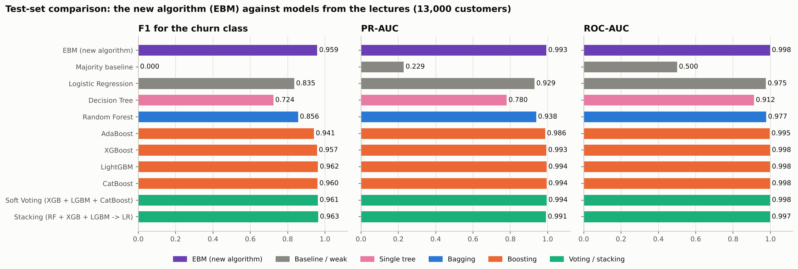
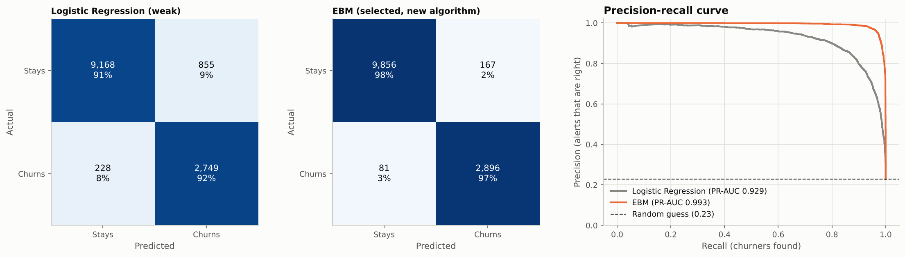
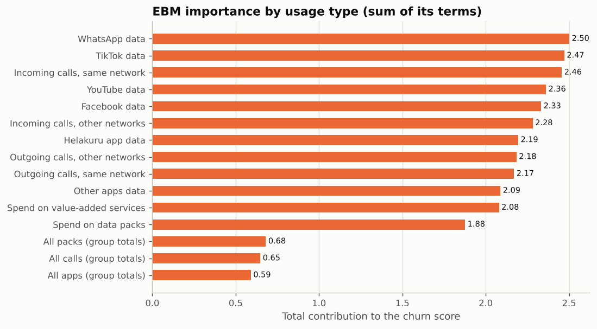
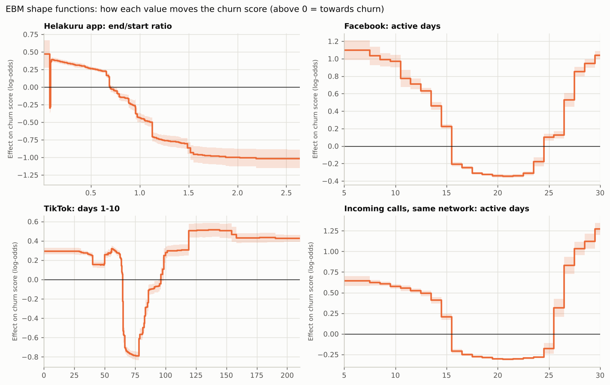
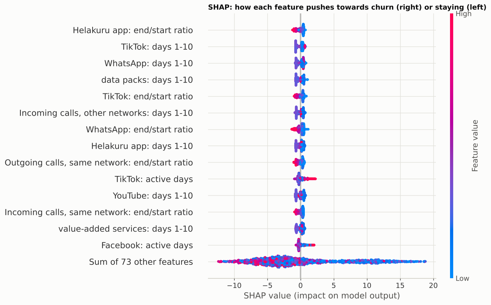
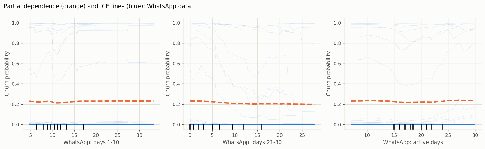
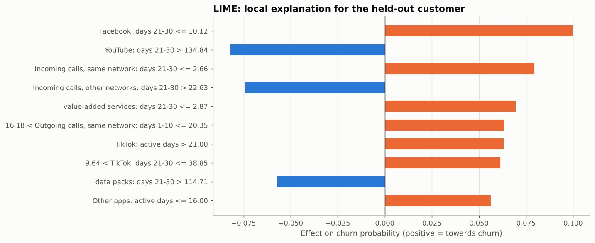
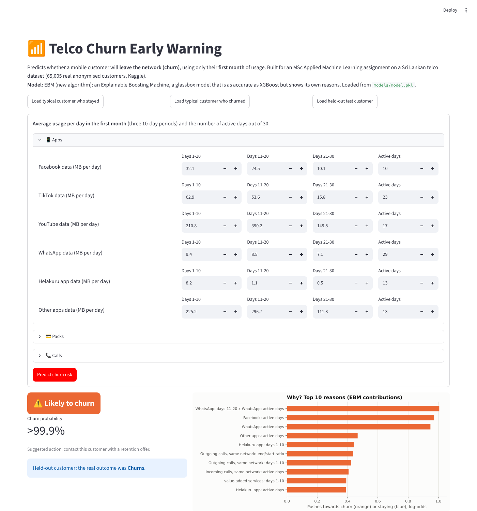

# Telco Churn Early Warning (Sri Lanka) with an Explainable Boosting Machine

MSc Applied Machine Learning assignment (IT 5504). Predicts which mobile customers of a Sri Lankan operator will **leave the network (churn)**, using only their **first month** of usage. The main model is an **Explainable Boosting Machine (EBM)**, a machine learning algorithm not covered in the lectures. It is compared with the lecture models (weak baseline up to stacked ensembles), explained with **EBM's own explanations, SHAP, PDP/ICE and LIME**, and served in a **Streamlit** app.

**Live app:** https://sl-telco-churn-ck.streamlit.app/

## 1. Problem and dataset

- **Problem:** Sri Lankan operators lose customers to competitors. Keeping one is cheaper than winning a new one, so operators want an early list of customers likely to leave, while a retention offer can still help. Binary classification: churn 1 = leaves, 0 = stays.
- **Data:** *Real World Customer Churn Dataset in Telco Domain* (Kaggle, Lasal Jayawardena, CC0): https://www.kaggle.com/datasets/lasaljaywardena/real-world-churn. 65,005 anonymised customers of one of the largest telcos in Sri Lanka, 1 January to 31 March 2023, with the author's train / test split (52,004 / 13,001). Churn rate 23%.
- **Features:** 12 daily usage types: Facebook, TikTok, YouTube, WhatsApp, **Helakuru**, other apps (MB), data packs and value-added services (LKR), and four call types (minutes). `data/raw/customer_first30.csv` is built from the original `main.csv` by `src/build_dataset.py`. For each usage type it holds the average per day in days 1-10, 11-20 and 21-30, plus active days (48 columns). `src/features.py` adds change, end/start ratio and group features, giving 90 features.
- **Ethics:** public CC0 data, anonymised customer IDs only, with no names, numbers, locations or demographics.

## 2. Leakage (key finding)

With all 90 days, every model scores **ROC-AUC 1.000**. Churners' usage collapses in months 2-3, so the model only sees that the customer has already left. **Only days 1-30 are used**, which makes this a real early-warning task. See `notebooks/01_eda.ipynb`.

## 3. The new algorithm: Explainable Boosting Machine

*g(P(churn)) = b + f₁(x₁) + … + fₖ(xₖ) + Σ fᵢⱼ(xᵢ, xⱼ)*

- A Generalized Additive Model. Each shape function fⱼ is learned by **cyclic gradient boosting**: many rounds of tiny trees, each trained on one feature only, with a small learning rate. Outer bagging smooths the result, and the strongest feature pairs are added as fᵢⱼ terms.
- It differs from Logistic Regression (curves instead of straight lines), Decision Trees (thousands of one-feature trees instead of one mixed tree), k-NN (a compact model with no scaling) and XGBoost (it stays additive, so the model *is* its explanation).
- **Why it was chosen:** retention officers need a reason for each alert. EBM gives exact reasons with boosting-level accuracy.
- **Tuning:** the number of pairwise interactions (0 to 200) and the step size were compared on a 20% validation split (`reports/ebm_tuning.csv`). Selected: 100 pairs, learning rate 0.015, 8 outer bags. Churners get sample weight ≈ 3.3.

## 4. Results (test set, 13,000 customers)

| Model | Accuracy | Precision | Recall | **F1 (churn)** | ROC-AUC | PR-AUC |
|---|---|---|---|---|---|---|
| **EBM (new algorithm, selected)** | **0.981** | 0.946 | 0.973 | **0.959** | 0.998 | 0.993 |
| Majority baseline | 0.771 | 0.000 | 0.000 | 0.000 | 0.500 | 0.229 |
| Logistic Regression (weak) | 0.917 | 0.763 | 0.923 | 0.835 | 0.975 | 0.929 |
| Decision Tree | 0.860 | 0.661 | 0.800 | 0.724 | 0.912 | 0.780 |
| Random Forest | 0.933 | 0.843 | 0.869 | 0.856 | 0.977 | 0.938 |
| AdaBoost | 0.973 | 0.949 | 0.933 | 0.941 | 0.995 | 0.986 |
| XGBoost | 0.980 | 0.944 | 0.971 | 0.957 | 0.998 | 0.993 |
| LightGBM | 0.983 | 0.954 | 0.970 | 0.962 | 0.998 | 0.994 |
| CatBoost | 0.981 | 0.940 | 0.981 | 0.960 | 0.998 | 0.994 |
| Soft Voting (XGB + LGBM + CatBoost) | 0.982 | 0.949 | 0.974 | 0.961 | 0.998 | 0.994 |
| Stacking (RF + XGB + LGBM -> LR) | 0.983 | 0.959 | 0.967 | 0.963 | 0.997 | 0.991 |




- EBM is as accurate as the black-box boosters and ensembles: within 0.004 F1 of the best, and slightly above XGBoost.
- Against the weak Logistic Regression, EBM cuts false alarms from 855 to 167 and missed churners from 228 to 81.
- Held-out customer (kept out of training and testing): churn probability above 0.999, and the customer really churned.

## 5. Explainability







- Churn shows as **falling and irregular use of all services together**; importance is spread over the 12 usage types (WhatsApp, TikTok and same-network incoming calls are highest).
- Helakuru end/start ratio: falling use pushes towards churn and rising use strongly towards staying. Few active days (about 15 or fewer of 30) also push towards churn. Both match domain knowledge.
- Some curves look like data artefacts (risk rising again at near-daily activity, a sharp TikTok dip). These are discussed in the report.
- For the held-out customer, EBM and LIME agree: Facebook, same-network calls and small daily services faded during the month.

## 6. Limitations, bias and ethics

- Scores are unusually high for churn. Several usage types have almost identical distributions, which suggests rescaled or partly generated data, so a live system would likely score lower.
- One operator and one quarter, with usage data only (no price plan, network quality or complaints data).
- The model uses no protected attributes, but usage can act as a proxy for income, region or age. Error rates should be checked per segment before real use. Predictions should support a human retention officer, under Sri Lanka's Personal Data Protection Act (No. 9 of 2022).

## 7. How to run

```bash
python -m venv .venv
.venv\Scripts\activate             # Windows (macOS / Linux: source .venv/bin/activate)
pip install --upgrade pip setuptools wheel
pip install -r requirements.txt
python src/train.py                # about 45-60 min (EBM tuning; add --retune to re-tune every model)
python src/evaluate.py
python src/explain.py
python src/predict.py
streamlit run app/app.py
```

## 8. Deployment (Streamlit Community Cloud)

Deployed at **https://sl-telco-churn-ck.streamlit.app/**

On https://share.streamlit.io choose **Create app**, then set repository `sl-telco-churn`, branch `main`, main file `app/app.py`, and Python 3.12. Streamlit uses the smaller `app/requirements.txt`. The app loads `models/model.pkl` (the pickled pipeline) and shows the churn probability, a suggested action and the 10 largest EBM contributions.



## 9. Project structure

```
data/raw/        customer_first30.csv, train_cxid.csv, test_cxid.csv, monthly_usage_check.csv
data/processed/  inference_sample.csv (held-out customer)
notebooks/       01_eda.ipynb, 02_models_and_explainability.ipynb
src/             config, build_dataset, features, train, evaluate, explain, predict, plot_style
models/          model.pkl (EBM pipeline), logistic_regression.pkl, feature_info.json
app/             app.py (Streamlit), requirements.txt
reports/         model_comparison.csv, ebm_tuning.csv, hyperparameters.csv, explanation outputs, figures/
```
